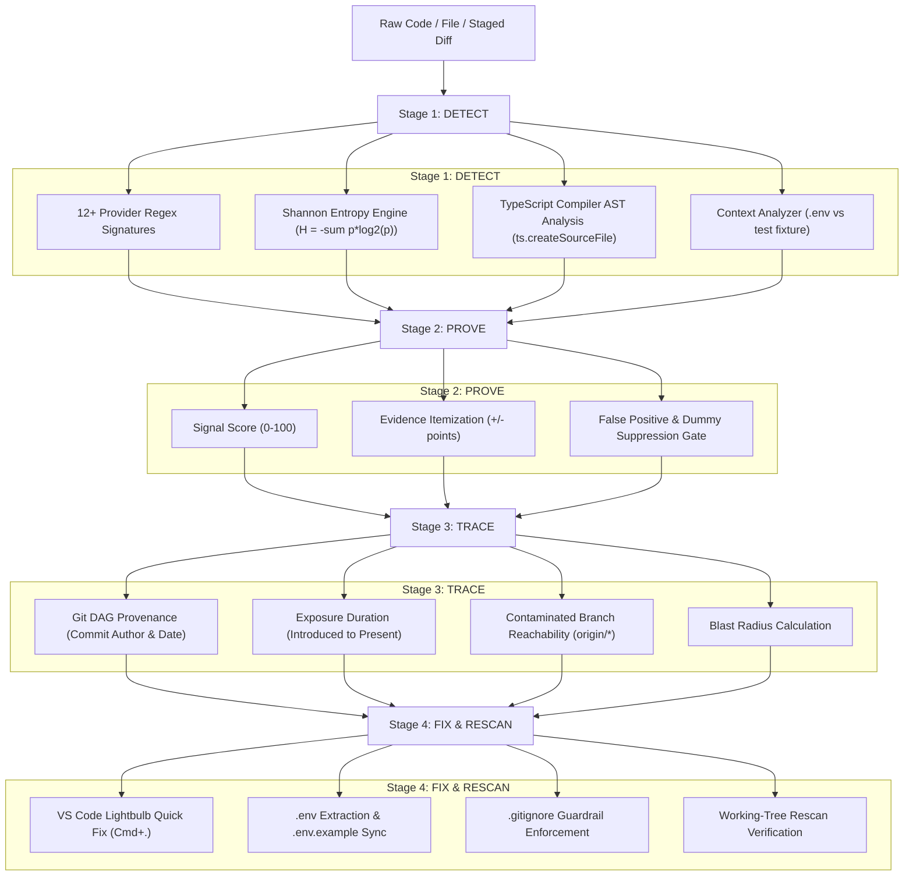

# 🛡️ LeakLock: Comprehensive Developer & Architectural Guide

---

## 1. What LeakLock Is

**LeakLock** is an enterprise-grade, developer-first credential leak detection, prevention, and remediation ecosystem. It operates directly on a developer's local workstation as a **Visual Studio Code extension**, a **fail-closed Git pre-commit barrier**, a **standalone CLI scanner**, and a **visual compliance dashboard**.

### The Core Problem It Solves
Hardcoded credentials (AWS keys, GitHub tokens, Stripe secrets, private keys, database connection strings) are the leading cause of massive data breaches. Traditional secret scanners (like basic regex scanners) suffer from three fatal flaws:
1. **High False-Positive Noise:** They flag test mock strings, variable names, and dummy samples, leading to developer alert fatigue.
2. **Passive Detection:** They detect leaks only after code has already been pushed to remote branches or GitHub.
3. **No Automated Remediation:** They tell developers *what* is wrong, but offer no safe, automated path to fix it without breaking runtime execution.

### LeakLock's Philosophy: DETECT → PROVE → TRACE → FIX
LeakLock is strictly differentiated by moving beyond simple regex matching into an explainable, 4-stage security lifecycle:
- **DETECT:** Multi-signal evaluation combining pattern matching, Shannon entropy, and official compiler AST analysis.
- **PROVE:** Calibrated Signal Scoring (0–100) with auditable evidence itemization.
- **TRACE:** Exposure graph analysis tracing introducing commits, contaminated branches, and duration.
- **FIX:** Transactional, one-click in-editor remediation with `.env` extraction, `.gitignore` synchronization, and diff previews.

---

## 2. How LeakLock Works: The 4-Stage Lifecycle



### Mathematical Shannon Entropy Formulation
For any string $S$ of length $L$ over an alphabet $\Sigma$, the Shannon entropy $H(S)$ is:
$$H(S) = -\sum_{c \in \Sigma} p(c) \log_2 p(c)$$
Where $p(c) = \frac{\text{count}(c)}{L}$. 
- Standard English / code variable names have $H \approx 1.5 - 3.2\ \text{bits/char}$.
- High-entropy cryptographic credentials have $H \ge 3.4 - 4.5\ \text{bits/char}$.

---

## 3. File-by-File Directory Breakdown

Below is the directory map of the LeakLock project:

```text
leaklock/
├── .vscode/
│   ├── launch.json              # VS Code extension F5 debug configuration
│   └── tasks.json               # Build automation tasks
├── dist/                        # Production compiled binaries & modular engines
│   ├── extension.js             # Bundled VS Code extension entry point (zero external dependencies)
│   ├── cli.js                   # Standalone bundled CLI executable
│   ├── cli/
│   │   ├── index.js             # CLI argument parser & subcommands (scan, trace, history, hook)
│   │   └── index.js.map         # Source map
│   ├── core/                    # Core platform engines
│   │   ├── types.js             # Core TypeScript interfaces (Finding, Risk, Evidence)
│   │   ├── scanner/scanner.js   # Master multi-pass file & buffer scanner
│   │   ├── detectors/
│   │   │   ├── rules.js         # 12+ Cloud provider signature definitions & entropy thresholds
│   │   │   └── validators.js    # Provider checksum validators (AWS, Stripe, GitHub, etc.)
│   │   ├── entropy/entropy.js   # Shannon entropy mathematical calculator & character set analyzer
│   │   ├── context/
│   │   │   ├── contextAnalyzer.js # Filepath, extension, and lexical line context analyzer
│   │   │   └── astAnalyzer.js   # TypeScript compiler AST parser (ts.createSourceFile)
│   │   ├── evidence/evidenceEngine.js # 0-100 Signal scoring and itemized evidence model
│   │   ├── classifier/falsePositiveClassifier.js # Dummy, test mock, and placeholder suppression
│   │   ├── risk/riskEngine.js   # Dynamic risk scoring (CRITICAL, HIGH, MEDIUM, LOW)
│   │   ├── history/
│   │   │   ├── gitHistoryEngine.js # Commit log scanner & commit author provenance
│   │   │   └── gitTimeline.js   # Exposure DAG graph & ASCII history timeline
│   │   ├── remediation/remediationEngine.js # Transactional code replacement & .env migration planner
│   │   ├── baseline/baselineEngine.js       # .secretleak-baseline.json CI/CD baseline gate
│   │   ├── redactor/redactor.js # Deterministic SHA-256 fingerprinting & secret masking
│   │   ├── sarif/sarifFormatter.js # OASIS SARIF v2.1.0 JSON report generator for GitHub Security
│   │   └── verification/verificationEngine.js # Provider verification abstractions
│   ├── diagnostics/
│   │   ├── diagnosticProvider.js # VS Code text document listener & squiggly underline emitter
│   │   └── codeActionProvider.js # VS Code lightbulb Quick Fix action provider
│   ├── sidebar/
│   │   └── findingsTreeProvider.js # VS Code Activity Bar tree view grouped by severity
│   ├── webview/
│   │   └── dashboardPanel.js    # Interactive HTML/JS Webview Security Dashboard
│   └── git/
│       └── gitService.js        # Fail-closed Git hook installer, diff mapper, and staged scanner
├── media/
│   ├── icon.png                 # 1024x1024 genuine PNG extension logo for the Marketplace
│   └── shield.svg               # Vector shield icon for the VS Code Activity Bar
├── src/                         # Full React 19 + Tailwind CSS Web Showcase application
│   ├── App.tsx                  # Interactive security compliance dashboard UI
│   ├── main.tsx                 # React entry mount
│   └── index.css                # Tailwind CSS v4 styling rules
├── .vscodeignore                # Packaging exclusion filter for vsce
├── index.html                   # HTML shell for Vite web dashboard
├── package.json                 # Extension manifest, commands, views, and CLI bin registration
├── LICENSE.txt                  # MIT License assigned to Sunny (Sunnyth)
└── README.md                    # Canonical documentation and user manual
```

---

## 4. How LeakLock Connects to VS Code & How It Is Published

### How LeakLock Connects to VS Code

VS Code extensions are event-driven Node.js programs running in a dedicated **Extension Host process**:

1. **Manifest Registration (`package.json`)**:
   - `main: "./dist/extension.js"` informs VS Code which module to load.
   - `activationEvents: ["onStartupFinished"]` activates LeakLock as soon as the editor finishes booting.
   - `contributes.commands`: Exposes commands to the Command Palette (`Cmd+Shift+P`).
   - `contributes.viewsContainers`: Adds the custom `leaklock-sidebar` icon to the primary Activity Bar.
   - `contributes.configuration`: Registers configuration keys under `leaklock.*`.

2. **Extension Lifecycle (`dist/extension.js`)**:
   - `activate(context: vscode.ExtensionContext)`:
     - Creates output channel: `vscode.window.createOutputChannel("LeakLock")`.
     - Initializes `DiagnosticProvider` and subscribes to `onDidSaveTextDocument` and `onDidChangeTextDocument`.
     - Registers `vscode.languages.registerCodeActionsProvider` to wire up the lightbulb Quick Fix.
     - Registers `vscode.window.registerTreeDataProvider` to feed data into the Activity Bar.
     - Registers command handlers (`leaklock.scanWorkspace`, `leaklock.scanStaged`, `leaklock.openDashboard`, `leaklock.installGitHook`).
   - `deactivate()`: Disposes output channels and background watchers.

### How LeakLock Is Packaged & Published

1. **Packaging into `.vsix`**:
   - A `.vsix` file is an Open Packaging Convention (ZIP) file containing:
     - `extension.vsixmanifest`: XML metadata describing publisher, version, and dependencies.
     - `[Content_Types].xml`: MIME type definitions.
     - `extension/`: The payload containing `dist/`, `media/`, `package.json`, `README.md`, and `LICENSE.txt`.
   - Packaged with:
     ```bash
     npx @vscode/vsce package --no-git-tag-version --no-dependencies
     ```

2. **Publishing to Visual Studio Marketplace**:
   - Requires a Microsoft Account and a Publisher profile on [marketplace.visualstudio.com/manage](https://marketplace.visualstudio.com/manage).
   - The publisher ID (`Sunnyth`) and unique package identifier (`leaklock-security`) are verified.
   - When uploaded, Microsoft's pipeline:
     1. Unpacks the VSIX.
     2. Validates image magic bytes (`media/icon.png` must be genuine PNG).
     3. Checks security and virus definitions.
     4. Distributes static assets to Azure CDN (`vsassets.io`).
     5. Makes the extension searchable in the VS Code marketplace.

---

## 5. Main Parts Every Developer Must Know

### 1. The Core Finding Data Structure
Every detected secret across the extension, CLI, and Webview is normalized to this structure:

```typescript
interface Finding {
  id: string;                      // Unique fingerprint ID: sec_<sha256_prefix>_<line>
  type: string;                    // e.g. "GitHub Personal Access Token"
  provider: string;                // e.g. "GitHub", "AWS", "Stripe"
  file: string;                    // Relative path (e.g. "src/config/auth.ts")
  fullPath: string;                // Absolute filesystem path
  line: number;                    // 1-indexed line number
  column: number;                  // 1-indexed column number
  redactedSecret: string;          // Masked representation (e.g. "ghp_••••••••••••3a9b")
  fingerprint: string;             // Deterministic SHA-256 hash (never exposes raw secret)
  confidence: number;              // 0 - 100 confidence score
  risk: "CRITICAL" | "HIGH" | "MEDIUM" | "LOW";
  riskAssessment: {
    score: number;                 // Calibrated 0 - 100 risk score
    level: string;
    blastRadius: {
      level: "MINIMAL" | "MODERATE" | "EXTENSIVE" | "SEVERE";
      score: number;
      summary: string;
    };
  };
  evidence: {
    items: Array<{
      category: string;
      description: string;
      confidenceImpact: number;   // e.g. +25 for pattern, +20 for high entropy
    }>;
    shannonEntropy: number;        // e.g. 4.82 bits/char
  };
  remediation: {
    targetVariable: string;        // Inferred variable name (e.g. "GITHUB_TOKEN")
    replacementCode: string;       // e.g. "process.env.GITHUB_TOKEN"
    envEntry: string;              // e.g. 'GITHUB_TOKEN="ghp_..."'
    steps: string[];
  };
}
```

### 2. Fail-Closed Git Pre-Commit Hook Security Guarantee
LeakLock guarantees that **no credential can bypass a commit**:
- Located at `.git/hooks/pre-commit`.
- Inspects `git diff --cached` against staged blob contents.
- If the scanner exits with non-zero or finds secrets with risk $\ge$ `HIGH`, the commit is **aborted immediately**.
- Existing user hooks are automatically preserved at `.git/hooks/pre-commit.sld-backup.<timestamp>` and chained.

---

## 6. Key Code Implementations & Explanations

### 1. Shannon Entropy Calculator (`dist/core/entropy/entropy.js`)
Calculates the exact degree of information randomness to eliminate low-entropy strings:

```javascript
function calculateShannonEntropy(str) {
  if (!str || str.length === 0) return 0;
  
  const freq = {};
  for (let i = 0; i < str.length; i++) {
    const char = str[i];
    freq[char] = (freq[char] || 0) + 1;
  }
  
  let entropy = 0;
  const len = str.length;
  for (const char in freq) {
    const p = freq[char] / len;
    entropy -= p * Math.log2(p);
  }
  
  return parseFloat(entropy.toFixed(3));
}
```
* **Explanation:** A 40-character human word like `"passwordpasswordpassword"` has low entropy ($H < 2.0$), whereas a cryptographic secret like `"ghp_1z8Ak9LpQ2XvM4Rn7T"` has high entropy ($H > 4.5$).

---

### 2. TypeScript Compiler AST Analyzer (`dist/core/context/astAnalyzer.js`)
Uses the official TypeScript compiler parser to inspect the syntax tree rather than trusting raw text:

```javascript
const ts = require("typescript");

function analyzeAstContext(lines, targetLineIndex) {
  const sourceCode = lines.join("\n");
  const sourceFile = ts.createSourceFile(
    "temp.ts",
    sourceCode,
    ts.ScriptTarget.Latest,
    true
  );

  let isAssignedToIdentifier = false;
  let inferredVariableName = undefined;

  function visit(node) {
    // Inspect variable declarations: const AWS_KEY = "..."
    if (ts.isVariableDeclaration(node) && node.initializer) {
      const line = sourceFile.getLineAndCharacterOfPosition(node.getStart()).line;
      if (line === targetLineIndex) {
        isAssignedToIdentifier = true;
        inferredVariableName = node.name.getText(sourceFile);
      }
    }
    // Inspect object property assignments: { secretKey: "..." }
    if (ts.isPropertyAssignment(node)) {
      const line = sourceFile.getLineAndCharacterOfPosition(node.getStart()).line;
      if (line === targetLineIndex) {
        isAssignedToIdentifier = true;
        inferredVariableName = node.name.getText(sourceFile);
      }
    }
    ts.forEachChild(node, visit);
  }

  visit(sourceFile);
  return { isAssignedToIdentifier, inferredVariableName };
}
```
* **Explanation:** By parsing with `ts.createSourceFile`, LeakLock understands whether a string literal is actively assigned to a sensitive variable (`const API_KEY = "..."`) or just passed inside a benign logger/comment.

---

### 3. One-Click Quick Fix Code Action (`dist/diagnostics/codeActionProvider.js`)
Provides the editor lightbulb action that rewrites code safely:

```javascript
class LeakLockCodeActionProvider {
  provideCodeActions(document, range, context) {
    const actions = [];
    for (const diagnostic of context.diagnostics) {
      if (!diagnostic.code || !diagnostic.code.toString().startsWith("sec_")) continue;
      
      const finding = this.findingStore.get(diagnostic.code.toString());
      if (!finding) continue;

      const fix = new vscode.CodeAction(
        `🛡️ LeakLock: Move ${finding.type} to .env and replace with process.env`,
        vscode.CodeActionKind.QuickFix
      );
      fix.isPreferred = true;
      fix.command = {
        command: "leaklock.remediateFinding",
        title: "Apply Remediation",
        arguments: [document.uri, range, finding]
      };
      actions.push(fix);
    }
    return actions;
  }
}
```
* **Explanation:** When triggered, it atomically appends the secret to `.env`, verifies `.env` is listed in `.gitignore`, creates a sanitized placeholder in `.env.example`, and swaps the in-file literal with `process.env.VAR`.

---

### 4. Deterministic SHA-256 Redactor (`dist/core/redactor/redactor.js`)
Prevents secondary secret leaks in logs, telemetry, and webviews:

```javascript
const crypto = require("crypto");

function generateFingerprint(secret) {
  return crypto.createHash("sha256").update(secret).digest("hex").substring(0, 16);
}

function redactSecret(secret) {
  if (!secret || secret.length <= 8) return "••••••••";
  const prefix = secret.substring(0, 4);
  const suffix = secret.substring(secret.length - 4);
  const maskedLength = Math.max(8, secret.length - 8);
  return `${prefix}${"•".repeat(Math.min(maskedLength, 24))}${suffix}`;
}
```
* **Explanation:** The raw secret is never stored or written to disk. Only its cryptographic hash fingerprint (`sec_9f8a2b3c...`) and visually masked preview (`ghp_••••••••••••3a9b`) are retained.
